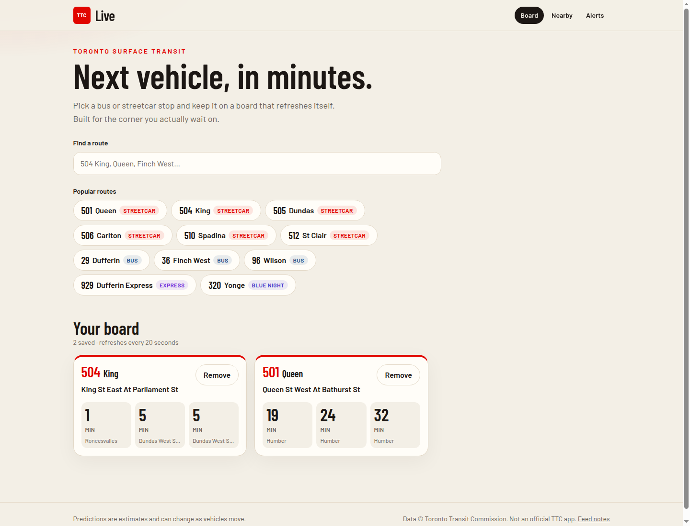
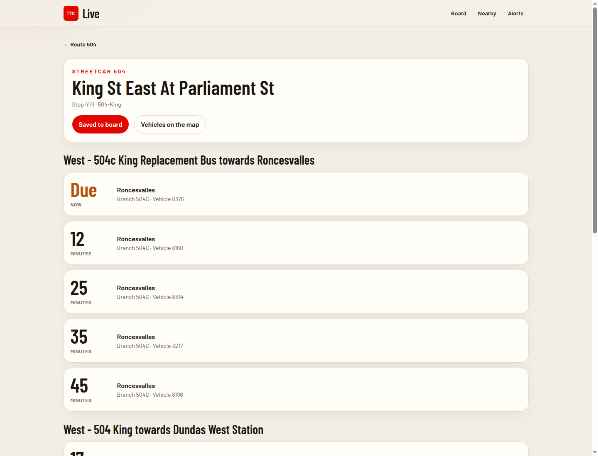
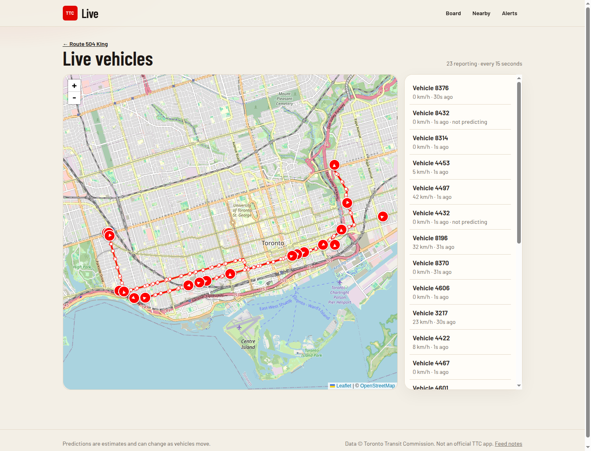

# TTC Live

Real-time arrivals for Toronto buses and streetcars. Search a route, pick the stop you actually wait at, and keep a board of favourites that refreshes itself.

**Live demo:** [https://ttc-live-dashboard.vercel.app](https://ttc-live-dashboard.vercel.app) 



## What it does

TTC Live is a departure board for surface transit. It does not try to be the official TTC site. It answers the question you have on the sidewalk: how many minutes until the next streetcar, and which branch is it?

Predictions update about every 20 seconds. Nothing here is a schedule — the numbers are the same live estimates the TTC publishes, and they move as vehicles do.

## Screenshots

**The board.** Saved stops, with the next three vehicles.


**A stop.** Every branch serving that pole, with vehicle numbers.



**The route.** Live vehicle positions on the 504 King.



## Features

- Search every bus, streetcar, express, and Blue Night route, then walk its directions and stops.
- Live predicted arrivals in minutes, including branch and vehicle number, with loading, empty, and error states.
- Save up to 12 favourite stops in this browser and see them together on the home board.
- Map of vehicles currently reporting on a route, plus the route path and a text list of the same vehicles.
- Nearby stops from the browser’s location, within 1.5 km, with arrivals on demand.
- Service alerts: detours, closures, reduced speed zones, and elevator outages, filterable by mode.
- Responsive layout, keyboard route search, a skip link, and an `aria-live` summary of the next arrival.

Subway train times are not in the prediction feed. Subway closures and elevator outages still show up under Alerts.

## Tech stack

- [Next.js](https://nextjs.org/) App Router and TypeScript
- React 19
- Tailwind CSS
- [SWR](https://swr.vercel.app/) for polling
- [Leaflet](https://leafletjs.com/) and OpenStreetMap tiles
- Vitest, ESLint, GitHub Actions

No API keys and no environment variables. A Vercel import builds it as-is.

## Architecture

The browser never calls the transit feeds. SWR polls same-origin route handlers, which fetch upstream, normalize the awkward JSON, and set cache headers.

```
Browser (SWR)
  └─ Next.js route handlers  /api/routes  /api/predictions  /api/vehicles  /api/alerts  /api/nearby
       ├─ Umo IQ / NextBus JSON     routes, stops, predictions, vehicles
       ├─ alerts.ttc.ca             service and accessibility alerts
       └─ src/data/stops.json       nearby search (haversine, no upstream call)
```

| Data | Upstream | Server cache | CDN |
| --- | --- | --- | --- |
| Route list and stop geometry | NextBus `routeList`, `routeConfig` | 6 hours | 1 hour |
| Predictions | NextBus `predictions` | 15 seconds | 10 seconds |
| Vehicle positions | NextBus `vehicleLocations` | 10 seconds | 8 seconds |
| Alerts | `alerts.ttc.ca/api/alerts/list` | 60 seconds | 60 seconds |

Favourites live in `localStorage` under `ttc-live-favourites-v1`. The home board asks for them in one `predictionsForMultiStops` request.

### Why this feed

Predictions, the route list, stop coordinates, and vehicle positions all come from the public Umo IQ / NextBus JSON feed, agency `ttc`:

```
https://retro.umoiq.com/service/publicJSONFeed?command=routeList&a=ttc
```

It needs no API key. It was checked from this project on 20 November 2026: 219 routes, live predictions (for example the 504 at King and Parliament), and vehicle positions.

The City of Toronto said this feed would be turned off on 30 November 2025 in favour of GTFS-Realtime on `bustime.ttc.ca`. That protobuf feed is the official successor, and it was also answering on the day this was built. It identifies stops with BusTime’s internal IDs, so using it well means carrying the Surface GTFS crosswalk. NextBus is still the no-key JSON API that can answer “minutes until the next car at this stop” directly. If it goes away, the parsers in `src/lib/nextbus` are the piece to replace.

Service alerts are a separate JSON document from `https://alerts.ttc.ca/api/alerts/list`, also with no key. The app reads both.

The nearby index is generated, not fetched per click:

```bash
npm run index:stops
```

That walks every route configuration and writes `src/data/stops.json` (about 9,000 stops). Commit the result when the board period changes.

## Getting started

Node.js 22 or newer.

```bash
git clone https://github.com/kelvinlct/ttc-live-dashboard.git
cd ttc-live-dashboard
npm install
npm run dev
```

Open [http://localhost:3000](http://localhost:3000). Search `504`, open King, and pick a stop.

## Testing

```bash
npm test          # unit tests for parsing, caching, favourites, and nearby search
npm run lint
npm run typecheck
npm run build
```

GitHub Actions runs all four on every pull request. The tests cover the feed’s real quirks: a single object instead of an array, string numbers, empty predictions, and duplicated vehicles. They do not call the network.

## Deploying

Push the repo to GitHub and import it on [Vercel](https://vercel.com/new). The framework preset is Next.js. There is nothing to set in the environment. Predictions stay fresh because the API routes send short `Cache-Control` headers and the page polls them.

## License

[MIT](LICENSE) © Kelvin Lau. Transit data is © Toronto Transit Commission and is not covered by this license. This project is not affiliated with the TTC. Map tiles © [OpenStreetMap](https://www.openstreetmap.org/copyright) contributors.
